# Prediksi IHSG dengan Multivariate Dual-Branch LSTM

Repositori ini berisi artefak penelitian skripsi (S1) dengan judul:

> **Analisis Prediksi Indeks Harga Saham Gabungan (IHSG) Menggunakan Multivariate Long Short-Term Memory (LSTM) Berdasarkan Data Historis dan Variabel Makroekonomi.**

Penelitian ini memprediksi IHSG **satu langkah ke depan (one-step ahead)** menggunakan **Multivariate LSTM** berarsitektur **dual-branch**, lalu membandingkannya secara objektif terhadap **baseline Univariate LSTM** pada periode pengujian yang sama. Penelitian tidak mengasumsikan salah satu pendekatan pasti lebih unggul, melainkan mengujinya secara empiris dengan metrik dan uji statistik yang terdefinisi.

---

## Ringkasan Hasil Utama 

Pada periode pengujian (21 Desember 2022 sampai 30 Desember 2024), model multivariate memperbaiki ketiga metrik titik dibanding baseline univariate:

| Metrik | Univariate | Multivariate | Arah |
|---|---|---|---|
| RMSE | 129,05 | **122,89** | lebih kecil lebih baik |
| MAPE | 1,42% | **1,35%** | lebih kecil lebih baik |
| R² | 0,809 | **0,827** | lebih besar lebih baik |

Namun uji **Diebold-Mariano** menunjukkan selisih tersebut **belum signifikan pada taraf 5%** (p = 0,082). Jadi kesimpulannya jujur: menambah variabel makroekonomi **memperbaiki prediksi secara konsisten arah**, tetapi buktinya belum cukup kuat untuk diklaim unggul secara statistik. Menariknya, keunggulan itu hampir seluruhnya berasal dari tahun 2024 (lihat [Analisis](#analisis)).

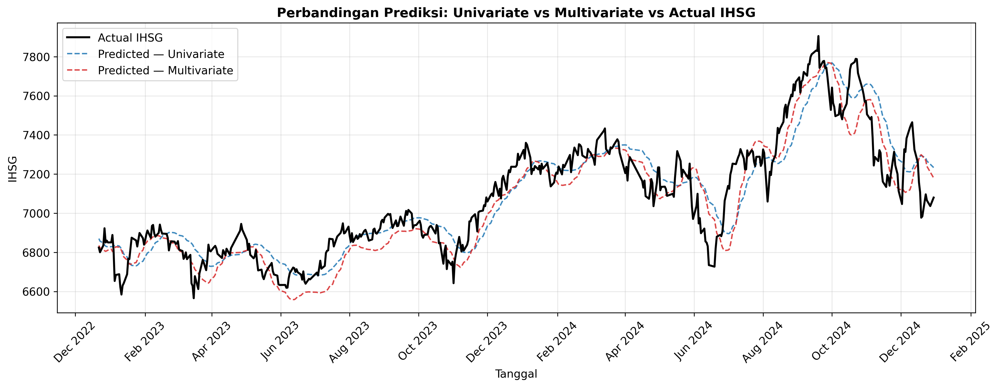

> Garis aktual IHSG dibandingkan prediksi model univariate dan multivariate sepanjang periode uji.

---

## Daftar Isi

- [Latar Belakang](#latar-belakang)
- [Data dan Variabel](#data-dan-variabel)
- [Eksplorasi Data (EDA)](#eksplorasi-data-eda)
- [Arsitektur Model](#arsitektur-model)
- [Proses Penelitian](#proses-penelitian)
- [Hasil](#hasil)
- [Analisis](#analisis)
- [Kesimpulan](#kesimpulan)
- [Struktur Repositori](#struktur-repositori)
- [Peta Notebook dan Keluarannya](#peta-notebook-dan-keluarannya)
- [Cara Menjalankan](#cara-menjalankan)

---

## Latar Belakang

IHSG dipengaruhi oleh dinamika pasar sekaligus kondisi makroekonomi. Model univariate yang hanya memakai riwayat IHSG mengabaikan informasi makro, sedangkan memaksa data makro bulanan ke frekuensi harian dapat menimbulkan redundansi dan informasi yang menyesatkan. Penelitian ini menguji apakah memasukkan variabel makroekonomi melalui arsitektur yang menghormati frekuensi asli tiap data benar-benar meningkatkan akurasi prediksi IHSG, dan seberapa besar kontribusinya dibanding baseline.

| Aspek | Keterangan |
|---|---|
| Objek | Indeks Harga Saham Gabungan (IHSG), harian |
| Periode | 2 Januari 2015 sampai 30 Desember 2024 |
| Target | Nilai IHSG satu langkah ke depan (t+1) |
| Model utama | Multivariate Dual-Branch LSTM |
| Baseline | Univariate LSTM (hanya IHSG) |
| Metrik | RMSE, MAPE, R² |
| Uji signifikansi | Diebold-Mariano (koreksi sampel kecil Harvey, Leybourne, Newbold) |

---

## Data dan Variabel

Empat variabel digabung dari sumber publik, dengan frekuensi asli yang berbeda.

| Jenis Data | Variabel | Frekuensi | Sumber |
|---|---|---|---|
| Pasar modal | IHSG | Harian | Bursa Efek Indonesia (BEI) |
| Makroekonomi | Nilai tukar Rupiah/USD (Kurs) | Harian | Bank Indonesia (BI) |
| Makroekonomi | Inflasi | Bulanan | Badan Pusat Statistik (BPS) |
| Makroekonomi | Suku bunga acuan (BI Rate) | Bulanan | Bank Indonesia (BI) |

Statistik deskriptif ringkas (lihat `reports/figures_v3/eda_descriptive.csv`):

| Variabel | Frekuensi | N | Rata-rata | Rentang |
|---|---|---|---|---|
| IHSG | Harian | 2.426 | 6.063,9 | 3.937,6 sampai 7.905,4 |
| Kurs (USD/IDR) | Harian | 2.426 | 14.318,8 | 12.472,5 sampai 16.575,0 |
| Inflasi (%) | Bulanan | 120 | 0,24 | -0,45 sampai 1,17 |
| BI Rate (%) | Bulanan | 120 | 5,25 | 3,50 sampai 7,75 |

Pengaturan data:

- **Split time-series 80:20**, cutoff **21 Desember 2022** (train 2 Januari 2015 sampai 20 Desember 2022; test 21 Desember 2022 sampai 30 Desember 2024).
- **Scaling** `MinMaxScaler`, dipaskan hanya pada data train untuk mencegah kebocoran informasi ke data uji.
- Data harian dan bulanan diproses terpisah sesuai frekuensinya, bukan diseragamkan secara paksa.

Detail proses: [notebook/preprocessing_multivariate_v2.ipynb](notebook/preprocessing_multivariate_v2.ipynb), menghasilkan artefak di `data/processed_v2/`.

---

## Eksplorasi Data (EDA)

Dilakukan di [notebook/eda_multivariate.ipynb](notebook/eda_multivariate.ipynb). Mencakup statistik deskriptif, visualisasi deret waktu, korelasi antarvariabel (dihitung pada frekuensi bulanan agar sepadan), dan uji stasioneritas Augmented Dickey-Fuller (ADF).

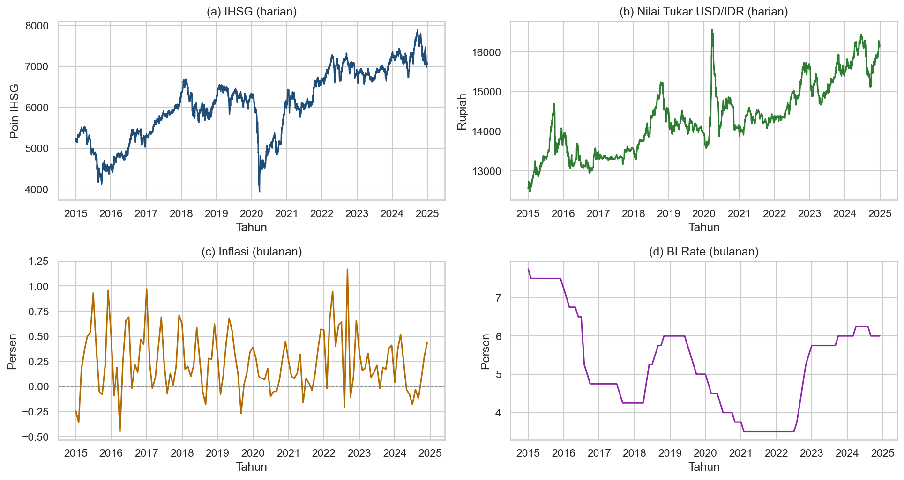

**Korelasi terhadap IHSG** (Pearson, frekuensi bulanan):

| Pasangan | Korelasi | Tafsiran |
|---|---|---|
| IHSG dan Kurs | 0,64 | sedang |
| IHSG dan BI Rate | -0,24 | lemah negatif |
| IHSG dan Inflasi | 0,04 | sangat lemah |

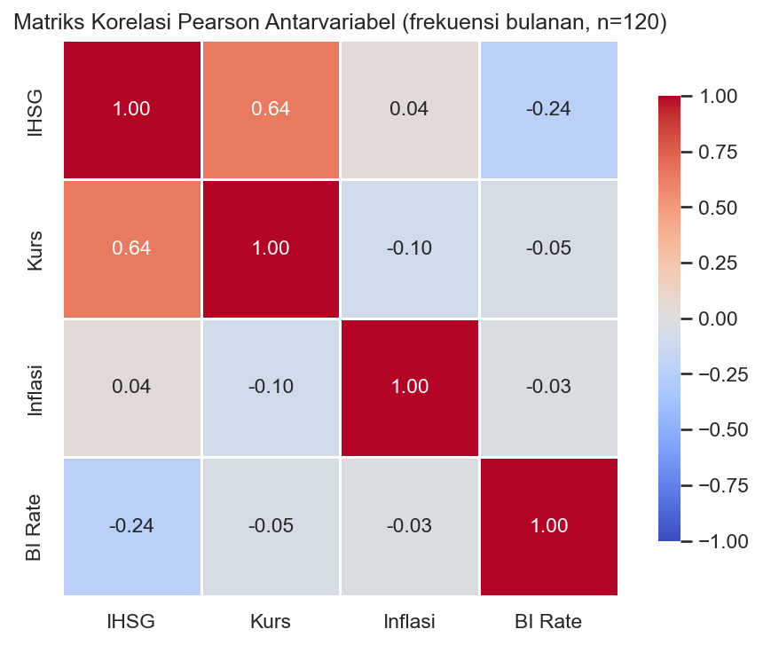

**Uji stasioneritas (ADF):** seluruh variabel **tidak stasioner** pada tingkat (nilai-p lebih besar dari 0,05: IHSG 0,518; Kurs 0,246; Inflasi 0,159; BI Rate 0,225). Temuan ini mendukung pendekatan berbasis sekuens dengan normalisasi, bukan model linier yang mengasumsikan stasioneritas.

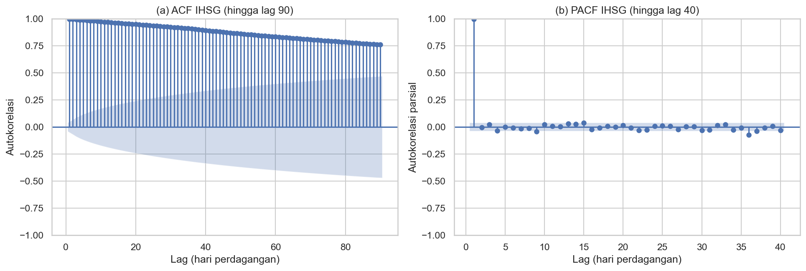

**Implikasi untuk pemodelan:** korelasi linier makro terhadap IHSG tergolong lemah sampai sedang, sehingga kontribusi variabel makro (kalau ada) kemungkinan bersifat nonlinier dan kondisional, bukan hubungan linier langsung. Inilah yang akan diuji lewat perbandingan model dan uji signifikansi.

---

## Arsitektur Model

Model utama adalah **Dual-Branch LSTM** (Keras Functional API) yang memproses dua kelompok data berfrekuensi berbeda secara terpisah namun simultan.

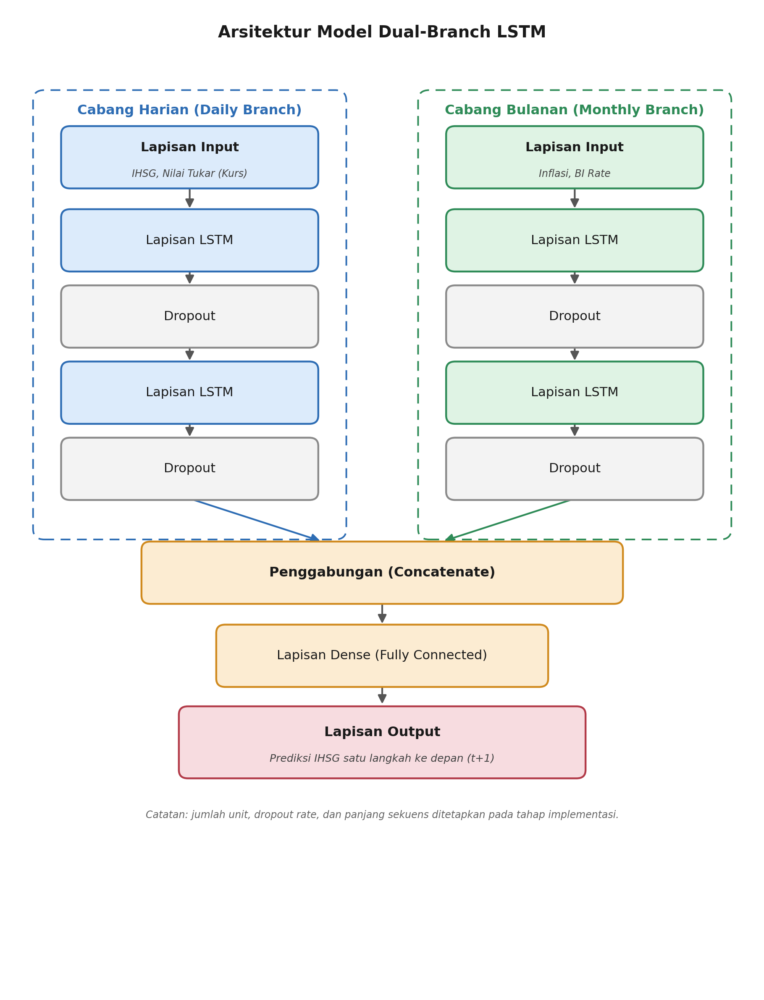

- **Cabang harian:** input IHSG dan Kurs (sekuens 90 hari).
- **Cabang bulanan:** input Inflasi dan BI Rate (sekuens 3 bulan).
- Keluaran kedua cabang **digabung pada tingkat representasi** (operasi *concatenate* atas vektor hasil LSTM masing-masing cabang, bukan menggabungkan data mentah berfrekuensi berbeda ke dalam satu sekuens), lalu diproses lapisan *Dense* untuk menghasilkan prediksi IHSG t+1.

Pemisahan dua cabang dipilih karena perbedaan frekuensi dan panjang sekuens. Alternatif *forward-fill* data bulanan ke harian akan membuat nilai berulang sekitar 21 kali (jumlah hari bursa per bulan) dan menimbulkan redundansi. **Baseline univariate** memakai rancangan setara satu cabang dengan input IHSG saja, agar perbedaan hasil hanya disebabkan perbedaan variabel input, bukan kapasitas arsitektur.

### Hyperparameter Final

| Parameter | Nilai |
|---|---|
| `seq_daily` | 90 |
| `seq_monthly` | 3 (dipilih via studi ablasi, RMSE terkecil) |
| `lstm_units` | 128 |
| `dropout` | 0,2 |
| `learning_rate` | 1e-4 |
| `batch_size` | 32 |

Nilai hyperparameter arsitektur dikunci dari observasi empiris pada eksperimen pendahulu: [modeling_multivariate.ipynb](notebook/modeling_multivariate.ipynb) (grid search) dan [modeling_multivariate_v2.ipynb](notebook/modeling_multivariate_v2.ipynb) (robustness multi-seed).

---

## Proses Penelitian

Alur mengikuti kerangka data mining (CRISP-DM): persiapan data, pemodelan, evaluasi, lalu analisis. Seluruh pemodelan ada di [notebook/modeling_multivariate_v3-2.ipynb](notebook/modeling_multivariate_v3-2.ipynb).

**1. Studi ablasi panjang sekuens bulanan.** Sebelum model final dikunci, panjang sekuens bulanan (`seq_monthly`) diuji pada beberapa kandidat. Nilai 3 bulan memberi RMSE terkecil dan dipakai pada model final.

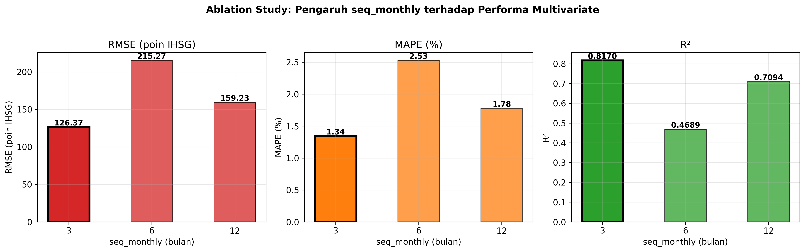

**2. Pelatihan model.** Model univariate dan multivariate dilatih pada data train yang sama dengan *early stopping*. Kurva loss menunjukkan keduanya konvergen tanpa overfitting berat.

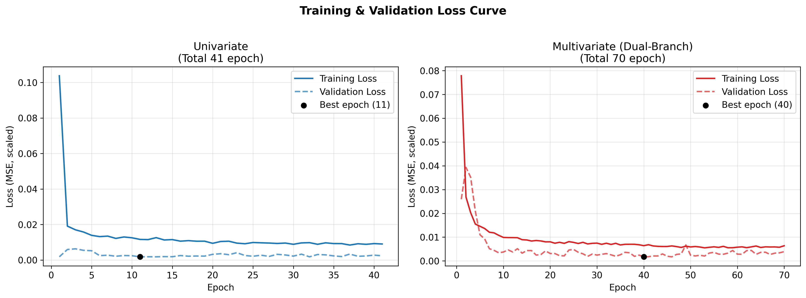

**3. Evaluasi.** Kedua model dievaluasi pada data uji yang sama memakai RMSE, MAPE, dan R². Visualisasi hasil dibuat di [notebook/visualisasi_multivariate_v3-2.ipynb](notebook/visualisasi_multivariate_v3-2.ipynb).

**4. Uji signifikansi.** Selisih galat kedua model diuji dengan Diebold-Mariano secara post-hoc (tanpa melatih ulang) di [notebook/uji_diebold_mariano.ipynb](notebook/uji_diebold_mariano.ipynb).

---

## Hasil

Pada data uji (485 hari), model multivariate unggul pada seluruh metrik titik.

| Metrik | Univariate | Multivariate |
|---|---|---|
| RMSE | 129,05 | **122,89** |
| MAPE | 1,42% | **1,35%** |
| R² | 0,809 | **0,827** |

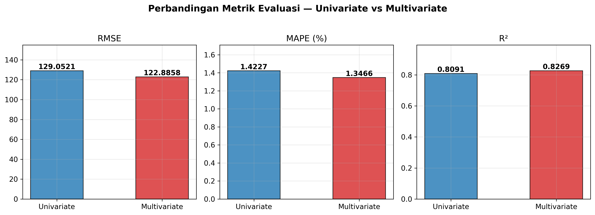

Prediksi multivariate mengikuti pergerakan aktual IHSG dengan baik di sebagian besar periode uji.

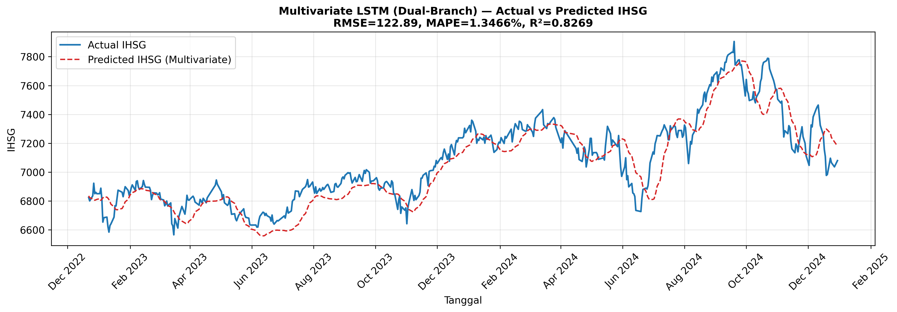

Sebaran titik prediksi terhadap nilai aktual juga rapat di sekitar garis diagonal ideal.

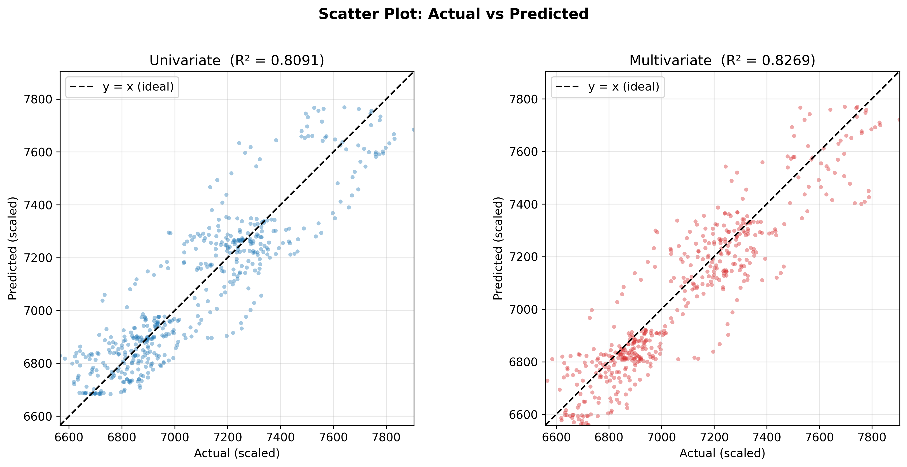

---

## Analisis

Angka agregat di atas belum menceritakan keseluruhan. Dua analisis berikut menjelaskan **kapan** dan **seberapa kuat** keunggulan multivariate.

### 1. Uji signifikansi Diebold-Mariano

| Fungsi loss | Statistik DM | nilai-p | Signifikan di 5%? |
|---|---|---|---|
| Squared error | 1,74 | 0,082 | Tidak |
| Absolute error | 1,86 | 0,063 | Tidak |

Arah uji konsisten menunjukkan multivariate lebih akurat, tetapi pada taraf 5% perbedaannya belum signifikan (gagal menolak hipotesis kesetaraan akurasi) dan hanya marginal pada taraf 10%. Artinya keunggulan multivariate nyata secara arah namun kecil secara besaran, sejalan dengan korelasi linier makro yang lemah pada tahap EDA.

### 2. Kinerja per subperiode

Di sinilah temuan paling menarik. Keunggulan multivariate ternyata **tidak merata** sepanjang periode uji (lihat `reports/figures_v3/per_subperiode.csv`):

| Subperiode | Model | RMSE | MAPE | R² |
|---|---|---|---|---|
| 2022 sampai 2023 | Univariate | **92,77** | **1,09%** | **0,555** |
| 2022 sampai 2023 | Multivariate | 94,75 | 1,14% | 0,536 |
| 2024 | Univariate | 158,13 | 1,76% | 0,530 |
| 2024 | Multivariate | **146,48** | **1,57%** | **0,597** |

Pada 2022 sampai 2023 kedua model setara, bahkan univariate sedikit lebih baik. Keunggulan multivariate baru muncul tegas pada **2024**, saat IHSG bergerak naik ke wilayah nilai di luar rentang data pelatihan. Pada kondisi pasar yang bergeser inilah variabel makroekonomi membantu model beradaptasi, sedangkan pada periode yang dekat dengan distribusi training tambahan makro tidak memberi manfaat. Ketidakmerataan ini juga menjelaskan mengapa uji DM atas seluruh periode hanya marginal: sinyal kuat di 2024 ter-rata-rata dengan periode yang netral.

Analisis galat mendukung gambaran ini. Residual dan distribusi error kedua model serupa, dengan selisih yang paling terasa pada periode akhir.

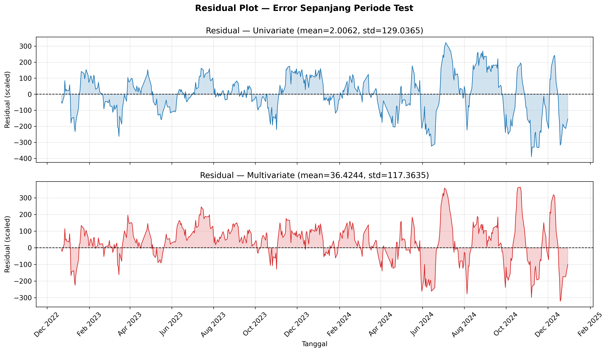
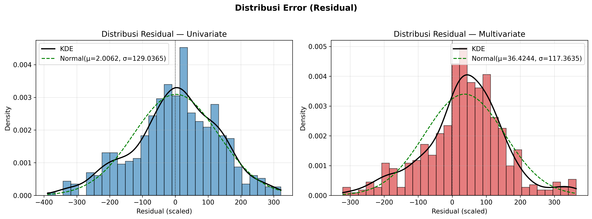

Rolling MAPE memperlihatkan periode di mana satu model unggul atas lainnya, dan perbesaran pada periode akhir menyoroti keunggulan multivariate saat IHSG menembus level baru.

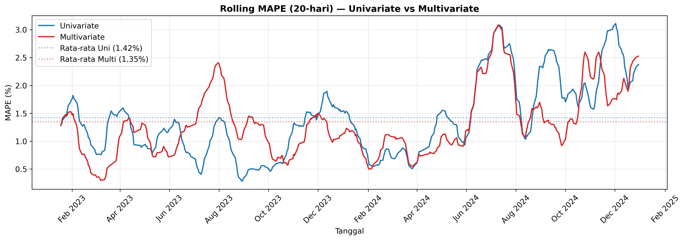
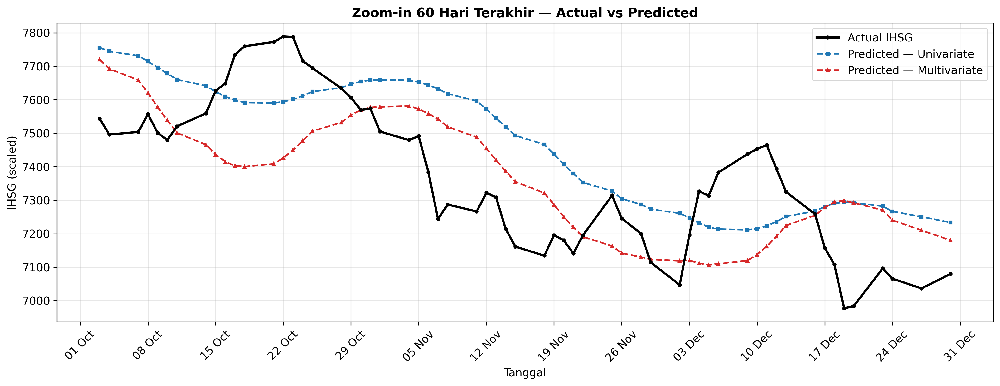

Figur lengkap lainnya tersedia di [reports/figures_v3/](reports/figures_v3/).

---

## Kesimpulan

- Menambahkan variabel makroekonomi melalui arsitektur dual-branch **memperbaiki** RMSE, MAPE, dan R² secara konsisten arah pada periode uji.
- Perbaikan tersebut **belum signifikan secara statistik** pada taraf 5% (Diebold-Mariano), jadi keunggulan multivariate tidak diklaim mutlak.
- Kontribusi makro **terkonsentrasi pada 2024**, ketika pasar bergerak ke wilayah di luar rentang pelatihan. Ini menunjukkan nilai variabel makro lebih terasa saat kondisi pasar bergeser, bukan di setiap periode.

---

## Struktur Repositori

```
.
├── notebook/                     # Kode: preprocessing, EDA, modeling, visualisasi, uji (sumber kebenaran)
├── data/
│   ├── raw/                      # Data mentah: IHSG, kurs, inflasi, BI rate
│   └── processed_v2/             # Artefak preprocessing final (train/test, scaler, sekuens)
├── model/
│   └── model_multivariate_v3/    # Model dan konfigurasi final (multivariate + univariate)
├── reports/
│   └── figures_v3/               # Seluruh figur hasil + CSV ringkasan (summary_table, per_subperiode, dll.)
├── README.md
└── .gitignore
```

---

## Peta Notebook dan Keluarannya

Jalankan berurutan. Semua path di notebook bersifat relatif dari folder `notebook/`.

### Pipeline final (inti penelitian)

| Tahap | Notebook | Apa yang dikerjakan | Keluaran |
|---|---|---|---|
| 1. Pra-pemrosesan | [preprocessing_multivariate_v2.ipynb](notebook/preprocessing_multivariate_v2.ipynb) | Membersihkan dan menyelaraskan data harian/bulanan, split train/test, scaling, pembentukan sekuens | `data/processed_v2/` |
| 2. EDA | [eda_multivariate.ipynb](notebook/eda_multivariate.ipynb) | Statistik deskriptif, deret waktu, korelasi, uji ADF | `reports/figures_v3/eda_*` |
| 3. Pemodelan dan evaluasi | [modeling_multivariate_v3-2.ipynb](notebook/modeling_multivariate_v3-2.ipynb) | Melatih univariate dan multivariate, studi ablasi `seq_monthly`, evaluasi RMSE/MAPE/R² | `model/model_multivariate_v3/` |
| 4. Visualisasi | [visualisasi_multivariate_v3-2.ipynb](notebook/visualisasi_multivariate_v3-2.ipynb) | Membuat seluruh figur hasil (01 sampai 11) | `reports/figures_v3/` |
| 5. Uji signifikansi | [uji_diebold_mariano.ipynb](notebook/uji_diebold_mariano.ipynb) | Uji Diebold-Mariano atas galat tersimpan (post-hoc) | `reports/figures_v3/dm_test_result.csv` |

### Eksperimen pendukung (dasar pemilihan hyperparameter)

Bukan pipeline final, melainkan eksperimen yang mendasari penguncian hyperparameter.

| Notebook | Keterangan |
|---|---|
| [modeling_multivariate.ipynb](notebook/modeling_multivariate.ipynb) | Eksperimen awal (v1): grid search hyperparameter. |
| [modeling_multivariate_v2.ipynb](notebook/modeling_multivariate_v2.ipynb) | Eksperimen lanjutan (v2): robustness multi-seed dan ablasi awal. |

---

## Cara Menjalankan

Prasyarat: Python 3.10 dengan TensorFlow/Keras, scikit-learn, pandas, numpy, matplotlib, seaborn, statsmodels, joblib.

```bash
# 1. Buat environment dan install dependensi
python -m venv .venv
# Windows:
.venv\Scripts\activate
# Linux/Mac:
source .venv/bin/activate

pip install tensorflow scikit-learn pandas numpy matplotlib seaborn statsmodels joblib jupyter

# 2. Jalankan notebook sesuai urutan pipeline di atas
jupyter notebook
```

Model final dan artefak preprocessing sudah disertakan, sehingga notebook pemodelan, visualisasi, dan uji dapat langsung dijalankan tanpa mengulang seluruh pelatihan.

---

## Catatan

- Seluruh kode penelitian berada di notebook Jupyter, bukan package Python.
- Repositori ini merupakan artefak penelitian; naskah skripsi dikelola terpisah.
